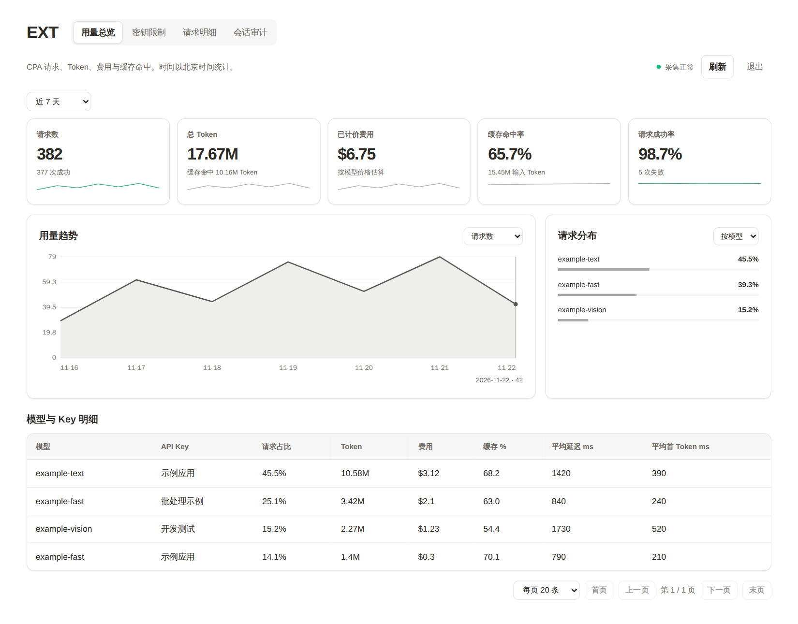
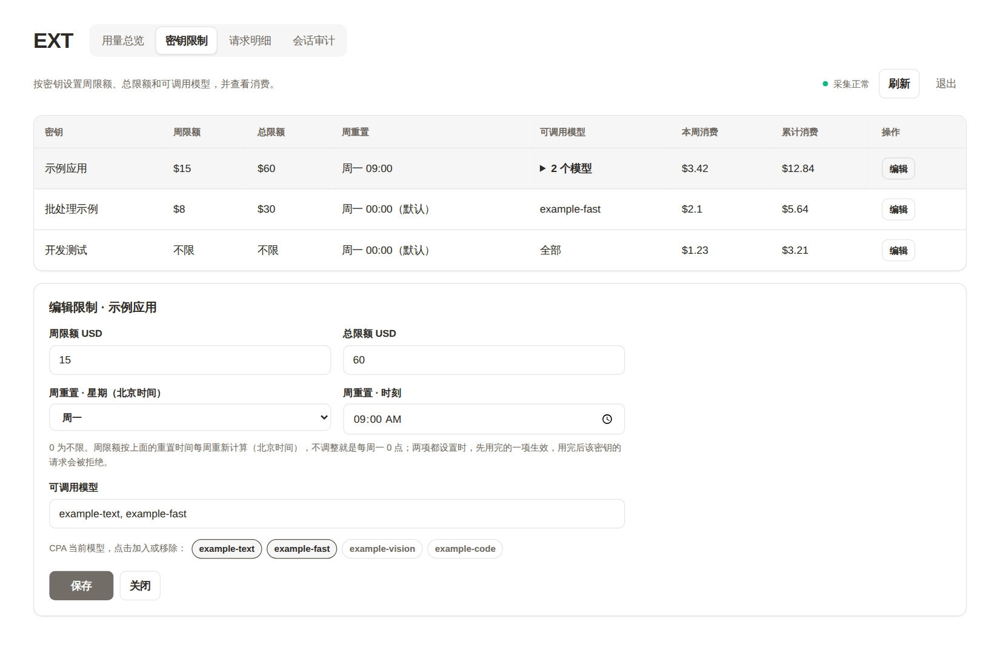

# EXT

EXT 是 CLIProxyAPI（CPA）的用量、限额与会话审计扩展。它通过原生插件出现在 CLIProxyAPI Management Center（CPAMC）的侧栏。上游凭证和客户端密钥在 CPAMC 管理，调用策略和用量在 EXT 查看。

## 界面预览

截图由实际界面渲染，所有模型、密钥名称和用量均为虚构示例。

**用量总览**展示请求趋势、模型分布、Token、估算费用和缓存命中率。用量总览、请求明细和会话审计共用北京时间筛选。



**密钥限制**跟随 CPA 的密钥顺序。每把密钥可配置周限额、总限额、周重置时间和可调用模型。



请求明细逐条展示调用结果、耗时、Token 和计价状态，并可跳转至关联的会话轮次。会话审计提供请求、回复和工具调用的记录。大型归档可在登录后下载。

## 快速开始

需要 Linux（AMD64 或 ARM64）、Docker Engine、Docker Compose、Git、curl 和 OpenSSL。当前配置使用 CPA `v8.1.0` 和 CPAMC `v1.28.3`。

```bash
git clone https://github.com/2Wren/EXT.git
cd EXT
bash deploy/init.sh
sudo docker compose -p cpa-ext up -d --build
```

初始化会生成 `.env`、下载并校验 CPAMC 页面，以及编译当前架构的原生插件。

1. 打开 `http://127.0.0.1:8482/management.html`，使用 `.env` 中的 `CPA_MANAGEMENT_KEY` 登录 CPAMC。
2. 在 CPAMC 添加上游凭证并创建客户端密钥。点击侧栏的 **EXT**，使用 `ADMIN_PASSWORD` 登录。
3. 将客户端指向 EXT 网关，使用刚创建的客户端密钥认证。OpenAI 兼容客户端的基础地址为 `http://127.0.0.1:8480/v1`。

| 默认回环端口 | 用途 |
| --- | --- |
| `8480` | 客户端 API 网关 |
| `8481` | EXT 独立管理界面及 API |
| `8482` | CPAMC、CPA 管理 API 和嵌入式 EXT 页面 |

服务默认绑定到 `127.0.0.1`。远程部署时，可用 SSH 隧道验证管理界面和网关，也可以按部署文档接入 HTTPS 反向代理。[部署与反向代理](deploy/README.md)

## 计价与数据

- **费用**基于 CPA 上报的 Token、公开价格目录和实例配置的费率。缺少价格的用量会保留为待计价，费率补齐后自动结算。
- **限额**按已入账的消费判断，周限额默认在北京时间周一 00:00 重置。在途请求可以在触及限额后完成。
- **存储**使用 SQLite 账本和 gzip 会话归档，数据保存在 `state/`。备份时应一并保存 `.env` 和 `state/`，归档可能包含请求正文和工具结果。[备份与恢复说明](deploy/README.md#data-and-maintenance)

## 开发与验证

Go 测试和静态检查可用 `go test ./...` 与 `go vet ./...` 运行。仓库还提供隔离端到端测试和 CPAMC 浏览器验收脚本。端到端测试使用模拟上游，覆盖流式转发、用量入账、密钥限制和大归档下载。[测试说明](deploy/README.md#data-and-maintenance)

## 相关项目

- [CLIProxyAPI](https://github.com/router-for-me/CLIProxyAPI)
- [CLIProxyAPI Management Center](https://github.com/router-for-me/Cli-Proxy-API-Management-Center)
